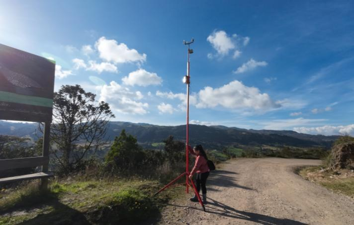
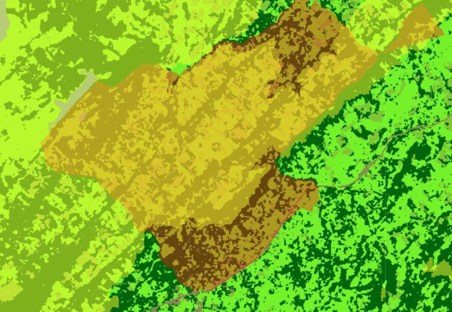
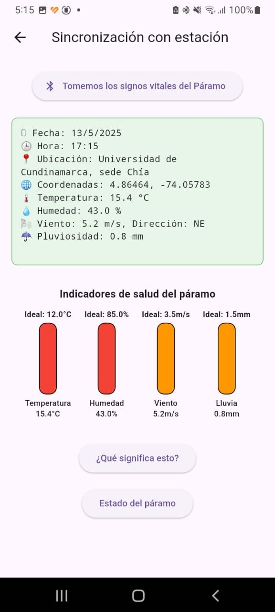
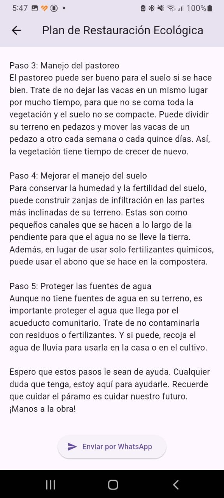

# RestaurAcción Digital

**Low-cost field sensing, geospatial targeting and expert-grounded AI to transfer ecological restoration practices to rural landholders in the Rabanal Páramo, Colombia**

Technical companion to the master's thesis:

> **Triana Barrantes, M. F. (2025).** *Secuencia didáctica con monitoreo climático y tecnología móvil para la enseñanza de prácticas de restauración ecológica en el Páramo de Rabanal* [Master's thesis, Maestría en Educación, Universidad de Cundinamarca, Chía, Colombia].

<p align="center">
  
  
  
  
</p>

## The problem

Páramos are high-Andean ecosystems that regulate the water supply of downstream towns and cities. Restoration depends on the families who farm them. Those families rarely have timely information about the condition of their land, and expert guidance is rarely adapted to their resources.

## What was built

An end-to-end system that takes a non-technical user from **data to decision** in a single 3-hour field session:

```
 WHERE to act          WHAT is happening        WHAT to do                    HOW it reaches people
┌──────────────┐     ┌──────────────────┐     ┌────────────────────────┐     ┌──────────────────────┐
│ Google Earth │ ──► │ Solar-powered    │ ──► │ Questionnaire (38 items)│ ──► │ Plan on the phone     │
│ Engine       │     │ weather station  │ BT  │ + GPT-4 grounded on an  │     │ via WhatsApp chatbot  │
│ overlay      │     │ (Micro:bit)      │     │ expert restoration plan │     │ + automated feedback  │
└──────────────┘     └──────────────────┘     └────────────────────────┘     └──────────────────────┘
```

| Component | Technology | Details |
|---|---|---|
| Geospatial targeting | Google Earth Engine: Sentinel-2 (cloud-masked), ESA WorldCover 2021, SRTM elevation, WDPA, Hansen GFC, GPM IMERG | [`geospatial/`](geospatial/methodology.md) · [scripts](geospatial/scripts/) |
| Weather station | Micro:bit + SparkFun weather sensors, Python, solar power, IP64, 5 m portable mast | [`hardware/station-design.md`](hardware/station-design.md) |
| Mobile app | Flutter (Android): vital-signs indicators, educational content, questionnaire | [`docs/architecture.md`](docs/architecture.md) |
| AI plan generation | FastAPI + OpenAI GPT-4, expert-grounded prompt, about USD 0.01 per plan | [`ai/README.md`](ai/README.md) |
| Delivery and evaluation | WhatsApp chatbot (Twilio Sandbox) | [`docs/architecture.md`](docs/architecture.md) |
| Learning design | Kolb's experiential cycle, connectivism, situated learning | [`education/README.md`](education/README.md) |

## Engineering highlights

- **Designed for zero infrastructure.** No grid power: the station runs on solar and battery. No internet in the field: Bluetooth links the station to the phone. No GIS server: the geospatial analysis runs in the cloud on public datasets.
- **AI with a knowledge boundary.** The language model adapts a restoration plan written by an expert instead of inventing one. Each output was reviewed against that plan.
- **Unit economics.** Station hardware costs about COP 1.8 M (about USD 450). Each AI plan costs about USD 0.01.
- **Built for low digital literacy.** Readings appear as "vital signs" with traffic-light colors. Plans use plain language with concrete examples. Plans arrive through the channel people already use.
- **Privacy-aware publication.** Each personal field in the questionnaire is flagged in the data dictionary. Nothing identifying is published. Photo GPS metadata is stripped.

## Pilot results

Pilot in Vereda Montoya, Ventaquemada (Boyacá), 2025: n = 5 inhabitants, 3 field visits, final Likert survey (1–5).

| Item | Favorable | Mean |
|---|---|---|
| Weather-station data understandable and useful | **100%** | 5.0 |
| Activities applicable in the community | 96% | 4.8 |
| AI restoration plan fit the participant's reality | 92% | 4.6 |
| App information understandable | 92% | 4.6 |
| WhatsApp chatbot answers clear and useful | 92% | 4.6 |
| Information on native species useful | 84% | 4.2 |

Data: [`data/pilot_results_summary.csv`](data/pilot_results_summary.csv). With n = 5, this is an exploratory validation, not a statistical generalization.

## Timeline

| Date | Milestone |
|---|---|
| April 2024 | Weather station electronics built |
| September 2024 | Station installed and calibrated in the Rabanal páramo |
| 2025 | Mobile app, AI integration and field pilot |
| 2025 | Thesis completed (Universidad de Cundinamarca) |
| 2026 | Technical documentation published in this repository |

## Repository structure

```
geospatial/   Earth Engine targeting method, maps and reproducible scripts (JavaScript)
hardware/     Station requirements, components, cost, data acquisition, calibration
ai/           Expert-grounded prompt design, expert base plan, risks and mitigations
data/         Questionnaire data dictionary (JSON) and aggregated pilot results (CSV)
education/    Teaching sequence, facilitator guide, survey instrument, consent template (Spanish)
docs/         Architecture, thesis summary, screenshots and field photos
```

The mobile application source code and the station firmware are not included in this publication. Participants' names, responses, phone numbers and the coordinates of private land have been excluded.

## Beyond the páramo

The pattern is reusable wherever expert knowledge must reach many dispersed, non-technical users at low cost:
- public geospatial data decides where to act;
- low-cost sensors show what is happening;
- an expert-grounded language model personalizes what to do;
- messaging apps deliver it.

## Author

**María Fernanda Triana Barrantes**, Systems Engineer; M.Ed., Universidad de Cundinamarca. Thesis advisor: Carlos Humberto Olivella Zuleta.

If you use this work, please cite it (see [`CITATION.cff`](CITATION.cff)).

## License

© 2025 María Fernanda Triana Barrantes. Original content licensed under [CC BY 4.0](https://creativecommons.org/licenses/by/4.0/). Third-party datasets and basemaps keep their own licenses: see [`DATA_SOURCES.md`](DATA_SOURCES.md).
