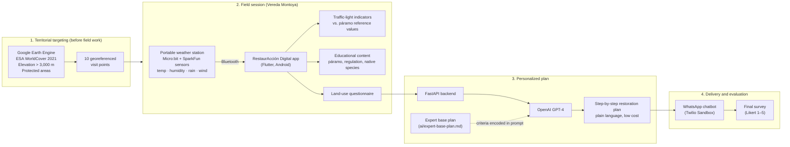

# Architecture

## End-to-end flow

## App screens

The screenshots are in `docs/images/screenshots/`.

| Screenshot | Screen | Purpose |
|---|---|---|
| `01_intro` | Introduction | Frames the station as the páramo's "vital-signs monitor". |
| `02_station_sync` | Station sync | Date, time, coordinates, temperature, humidity, wind and rainfall, with traffic-light indicators. |
| `03_indicators_explained` | What does it mean? | Plain-language meaning of each out-of-range indicator. |
| `04_paramo_status` | Páramo status | How a "sick" páramo shows in each variable. |
| `05_learn_about_paramo` | Learn | Ecological importance, Colombian páramo regulation, restoration, native species. |
| `06_questionnaire` | Questionnaire | Plot information, soil and vegetation, water management, farming practices, willingness to restore, technology access. |
| `07_generate_plan` | Generate plan | Sends the answers for AI processing. |
| `08_ai_restoration_plan` | Plan | Personalized restoration plan, ready to send by WhatsApp. |

## Indicator logic

Each reading is compared with its páramo reference value:

- **Green:** within tolerance.
- **Orange:** up to twice the tolerance.
- **Red:** beyond twice the tolerance.

| Variable | Reference | Tolerance |
|---|---|---|
| Temperature | 12.0 °C | ±1.5 |
| Relative humidity | 85% | ±5 |
| Wind speed | 3.5 m/s | ±1.0 |
| Rainfall | 1.5 mm | ±0.5 |

## Design decisions

- **Plain language by design.** The prompt requires concrete examples instead of technical terms, because many participants have limited formal schooling. For example, it asks for "plant shrubs along the slope so the water doesn't wash the soil away" instead of "live barrier".
- **Expert-guided AI.** The prompt encodes the criteria of an expert base plan:
  - viable with the landholder's own resources;
  - low cost;
  - compatible with current production;
  - organized in progressive steps.

  The full expert plan is published in `ai/`. Each generated plan was reviewed against it during the pilot.
- **Low cost.** About USD 0.01 per generated plan. The station uses off-the-shelf educational hardware.
- **Phone-first delivery.** WhatsApp was chosen because it is the channel participants already use.
