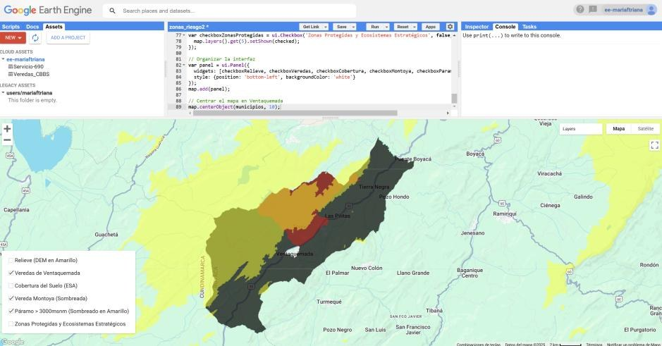
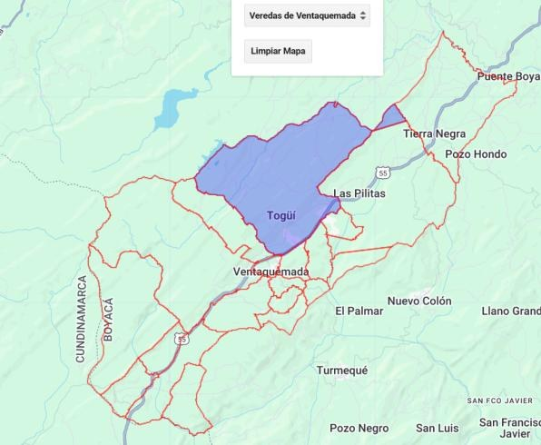
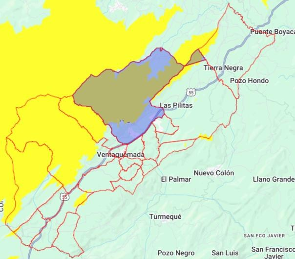
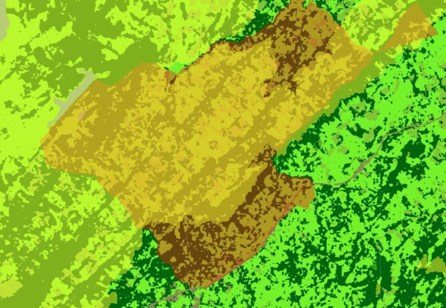
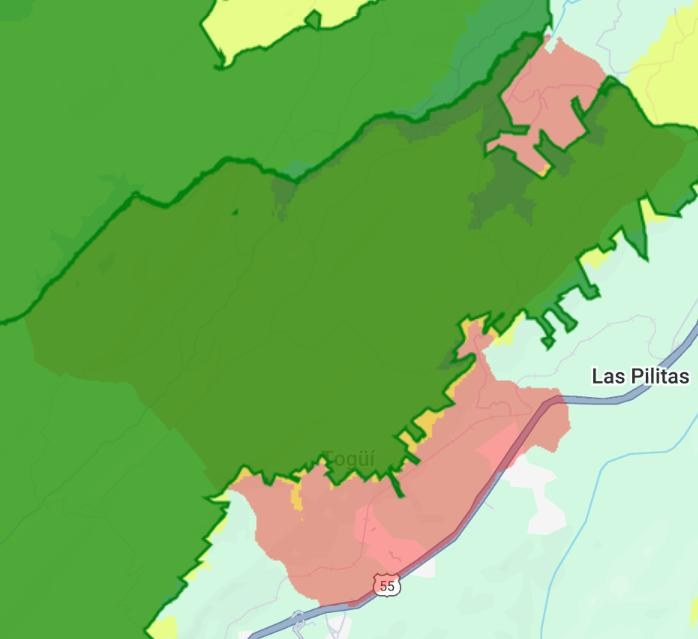

# Geospatial targeting in Google Earth Engine

**Goal:** decide *where* to run the teaching sequence by locating páramo areas under human pressure in Vereda Montoya (Ventaquemada, Boyacá). The result fixed the route for the field visits.

Google Earth Engine (GEE) was chosen because it is free for research and education, runs in the browser, and hosts global land-cover and elevation datasets, so no local GIS infrastructure is needed.

*GEE Code Editor with the layer stack used in the analysis.*

## Layer stack and decision logic

| Step | Layer | Source | Rule |
|---|---|---|---|
| 1 | Administrative boundaries (municipality and veredas) | Vereda boundary shapefile, uploaded as a GEE asset | Isolate Vereda Montoya inside Ventaquemada |
| 2 | Elevation | Digital elevation model | Keep areas **> 3,000 m a.s.l.**, the legal páramo threshold for the Eastern Cordillera |
| 3 | Land cover | **ESA WorldCover 2021** (European Space Agency, 10 m) | Flag cover classes that indicate vegetation loss |
| 4 | Protected areas and strategic ecosystems | Official protected-area layers | Distinguish protected from unprotected páramo |
| 5 | Overlay | Intersection of steps 1–4 | **Critical area = páramo altitude ∩ vegetation loss**, read against protection status |
| 6 | Field targets | Manual selection on the overlay | 10 georeferenced visit points along the affected zone |

|  |  |
|---|---|
| 1. Ventaquemada (red outline) and Vereda Montoya (blue) | 2. Areas above 3,000 m a.s.l. (yellow): most of Montoya is páramo |
|  |  |
| 3. ESA WorldCover 2021: dark zones are vegetation loss within páramo altitude | 4. Protected areas (green): they overlap most of the páramo, but not all of it |

*Basemap: Map data © Google. Land cover: © ESA WorldCover project 2021, contains modified Copernicus Sentinel data. Full credits: [`../DATA_SOURCES.md`](../DATA_SOURCES.md).*

## Output

- A map of critical páramo areas in Vereda Montoya: high-altitude land with vegetation loss, partly outside protected areas.
- **10 georeferenced points** used as references to plan the field visits and place the weather station. The exact coordinates are omitted here because some fall on or near private land; they are documented in the thesis.

## Scripts

Reproducible Earth Engine scripts for this workflow are in [`scripts/`](scripts/). They include cloud-masked Sentinel-2 change detection and the critical-area rule with patch-based field targets.

## Why it matters for the system

The geospatial step gives the rest of the pipeline its spatial context:
- the weather station is deployed where degradation was detected;
- the teaching sequence is delivered to the people who manage that land;
- the AI plan is generated for plots inside the critical zone.

The same pattern (public satellite layers → rule-based overlay → field targets) can be reused for any region where field effort must be prioritized with limited budget.
