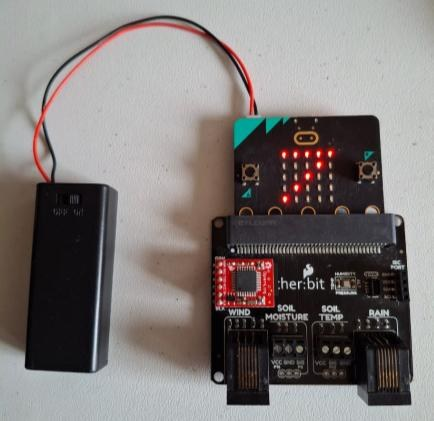
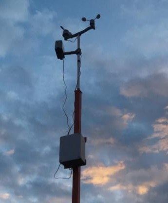
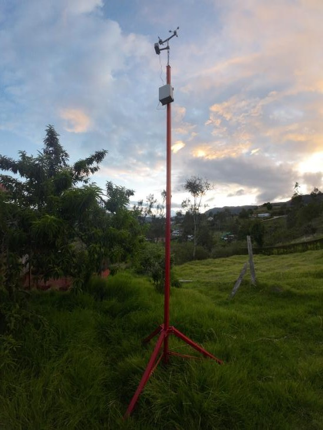
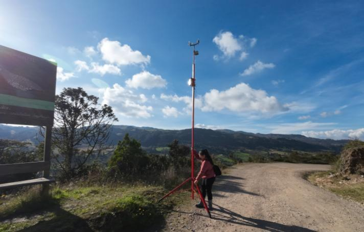
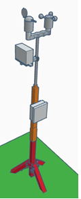
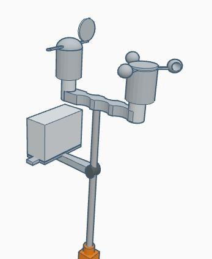
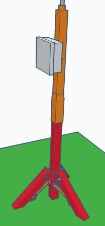

# Portable weather station ("estación itinerante de monitoreo")

A low-cost, solar-powered, portable weather station designed to bring live climate readings to field workshops in a high-mountain ecosystem with no grid power and no internet coverage.

| | |
|---|---|
|  |  |
| Micro:bit on a SparkFun weather carrier board (wind, rain, soil inputs) with battery pack | Sensor head installed: anemometer, wind vane, rain gauge and IP64 enclosure |
|  |  |
| Assembled station during calibration tests | Station deployed in the Rabanal páramo |

## 1. Design requirements

Requirements were defined from the field conditions of the páramo:

| Requirement | Design response |
|---|---|
| Representative measurements | Wind and rain sensors at the top of the mast (5 m) to avoid vegetation bias; temperature and humidity at 2 m, following World Meteorological Organization (WMO) practice |
| Uneven, sloped terrain | Three-leg base with independently adjustable legs to level the mast horizontally and vertically |
| Strong winds | Galvanized hardware, metal profile structure, wide tripod base |
| Portability (field visits on foot) | Two-piece mast (5 m assembled, 2.5 m disassembled), ±50 cm height adjustment |
| Hostile weather (permanent humidity, rain, UV) | IP64 enclosure for electronics; anti-corrosion and UV paint |
| No grid electricity | Autonomous power: photovoltaic panel + charge controller + backup battery (works through cloudy periods and at night) |
| No internet coverage | Short-range wireless link (Bluetooth) from the station to a phone; no cloud dependency in the field |
| Visibility and wildlife safety | High-visibility orange/red colors; UV-reflective paint to reduce bird collisions with the mast |
| Non-technical users | Readings shown as "vital signs" with traffic-light indicators in the mobile app |

The design was modeled in 3D before construction:

|  |  |  |
|---|---|---|
| Full station | Sensor head and enclosure | Adjustable tripod base |

## 2. Components and cost

Estimated investment, from Table 6 of the thesis, in Colombian pesos (COP):

| Subsystem | Item | Qty | Cost (COP) |
|---|---|---|---|
| Sensing | Weather sensors: temperature, humidity, rainfall, wind speed and direction | 1 per variable | 900,000 |
| Processing | Micro:bit board | 1 | 200,000 |
| Power | Solar panel (with charge controller and backup battery) | 1 | 150,000 |
| Structure | Adjustable metal structure (5 m mast, tripod base) | 1 | 500,000 |
| Protection | IP64 enclosures | 1 set | 50,000 |
| **Station total** | | | **1,800,000** |

The station total is about USD 450 at 2024 exchange rates. The full teaching sequence costs COP 2,700,000, which adds:
- app maintenance;
- the AI module;
- cloud servers;
- native trees;
- SIM cards;
- transport for 4 field visits.

## 3. Data acquisition

The firmware is written in Python on the Micro:bit. On each cycle it:

1. reads every sensor (temperature, relative humidity, rainfall, wind speed, wind direction);
2. builds a data frame with **date, time and station geoposition** attached to the readings, so each record can be analyzed by zone;
3. transmits the frame wirelessly via Bluetooth to the mobile app, which must be within range of the station.

In the app, each variable is compared with a páramo reference value and shown as green, orange or red. The thresholds are in [`docs/architecture.md`](../docs/architecture.md).

## 4. Build, calibration and field validation

| Date | Milestone |
|---|---|
| April 2024 | Electronics assembled; sensors integrated with the board; enclosure sealing tested |
| September 2024 | Station transported disassembled to the Rabanal páramo; installation and calibration on site |
| 2025 | Field pilot with páramo inhabitants (3 visits) |

**Pre-visit checks** (thesis, pilot protocol):
- solar charging performance;
- IP64 sealing against wind and rain;
- sensor calibration within expected ranges;
- data transmission to the phone.

Each sensor was calibrated individually: temperature, humidity, rain gauge, anemometer and wind vane. It was also tested at different heights and in different climates, including environments outside the páramo, to check the variation and stability of the readings.

## 5. Lessons learned

- **Power autonomy is the critical constraint.** Persistent cloud cover required a battery buffer, not just a panel.
- **Leveling matters as much as the sensor.** Adjustable legs were essential on sloped páramo terrain to keep the wind vane and rain gauge reliable.
- **Field users value interpretation over raw numbers.** Every participant (100%) rated the station data as understandable and useful, once readings were translated into traffic-light "vital signs".
